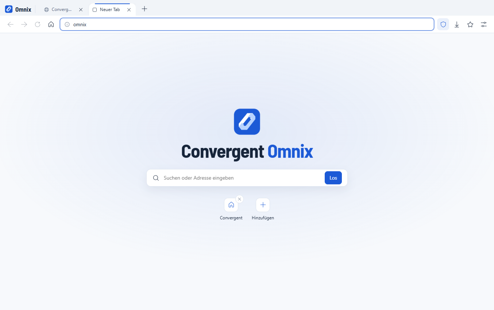
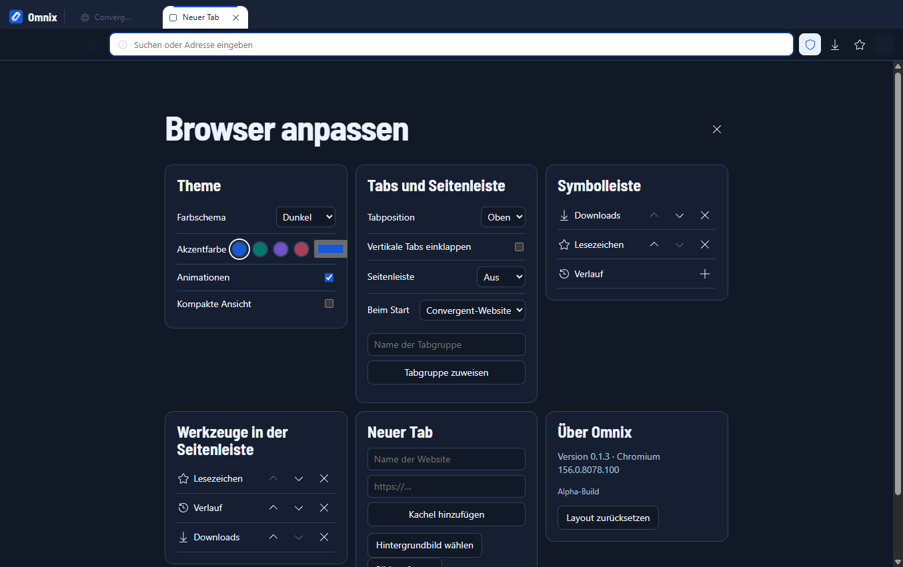

<p align="center">
  
</p>

<h1 align="center">Convergent Omnix</h1>

<p align="center">Ein Chromium-Browser für Windows mit Werbe- und Trackerschutz und einer Oberfläche, die du selbst einrichten kannst.</p>

<p align="center">
  <strong><a href="https://github.com/eronbubi/Omnix/releases/download/v0.1.3/Convergent-Omnix-0.1.3-x64-Setup.exe">Windows-Installer herunterladen</a></strong>
  · <a href="https://github.com/eronbubi/Omnix/releases/tag/v0.1.3">v0.1.3 Alpha</a>
  · <a href="https://github.com/eronbubi/Omnix/issues">Feedback</a>
</p>



## Funktionen

| Bereich | In Omnix verfügbar |
| --- | --- |
| **Omnix-Schild** | Braves Filter-Engine blockiert Anfragen mithilfe von EasyList, EasyPrivacy und EasyList Germany. Das Schild zeigt blockierte Anfragen und erlaubt Ausnahmen pro Website. |
| **Phishing und schädliche Downloads** | Omnix prüft Adressen gegen lokale Bedrohungslisten und übergibt heruntergeladene Dateien an die Windows-Anlagenprüfung. |
| **Tabs und Seitenleisten** | Tabs oben oder links, Tabgruppen, eine umsortierbare Symbolleiste und Werkzeuge für Lesezeichen, Verlauf und Downloads. |
| **Aussehen** | Heller, dunkler oder systemabhängiger Modus, eigene Akzentfarben und Hintergrundbilder. Die Tippanimation in der Adressleiste berücksichtigt die Windows-Einstellung für reduzierte Bewegung. |
| **Start und neuer Tab** | Wähle zwischen der Convergent-Website, einem neuen Tab und der letzten Sitzung. Website-Kacheln lassen sich hinzufügen, sortieren und entfernen. |

## Download

1. Lade den [Installer für Windows 11 x64](https://github.com/eronbubi/Omnix/releases/download/v0.1.3/Convergent-Omnix-0.1.3-x64-Setup.exe) herunter.
2. Starte die Setup-Datei und folge dem Installationsdialog.
3. Öffne **Convergent Omnix** aus dem Windows-Startmenü.

Der Installer ist unsigniert. Über `Get-FileHash` kannst du prüfen, ob der Download dem veröffentlichten Paket entspricht. Vergleiche den angezeigten Wert mit der [SHA-256-Prüfsumme](https://github.com/eronbubi/Omnix/releases/download/v0.1.3/SHA256SUMS.txt).

```powershell
Get-FileHash -Algorithm SHA256 .\Convergent-Omnix-0.1.3-x64-Setup.exe
```

## Omnix einrichten



- Klicke rechts neben der Adressleiste auf **Browser anpassen**, um Tabs, Farben und Werkzeuge einzurichten.
- Wähle **Beim Start → Neuer Tab**, wenn Omnix direkt die lokale Suche und deine Kacheln zeigen soll. Mit **×** kannst du eine Kachel direkt im neuen Tab entfernen.
- Drücke **Strg+L** für die Adressleiste, **Strg+T** für einen neuen Tab oder **Strg+W** zum Schließen des aktuellen Tabs.

## Schutz in der Alpha

- **Bedrohungslisten** werden beim Build mitgeliefert und lokal abgefragt. Das Datum findest du im Omnix-Schild.
- **Downloadprüfung** nutzt die Windows-Anlagenprüfung. Die Erkennung hängt von deinem aktiven Windows-Virenschutz ab.
- **Updates** werden in dieser Alpha manuell über [GitHub Releases](https://github.com/eronbubi/Omnix/releases) installiert.

## Feedback

Wenn dir ein Fehler auffällt, erstelle ein [GitHub-Issue](https://github.com/eronbubi/Omnix/issues/new). Nenne deine Omnix- und Windows-Version, die Schritte zum Nachstellen und was dabei passiert. Die Omnix-Version steht unter **Browser anpassen → Über Omnix**.

[Convergent-Website](https://convergent-web.vercel.app/)

Convergent Omnix ist proprietäre Software. Dieses Repository enthält Downloads, Versionshinweise und Support.
